<div align="center">


# Surge Publisher

**Publish static websites to [Surge.sh](https://surge.sh) with one click.**
A simple, open-source desktop app: no terminal, no commands to remember.

[Download](https://github.com/farizmohd70/surge-publisher/releases) ·
[Report a bug](https://github.com/farizmohd70/surge-publisher/issues) ·
[Contribute](CONTRIBUTING.md)


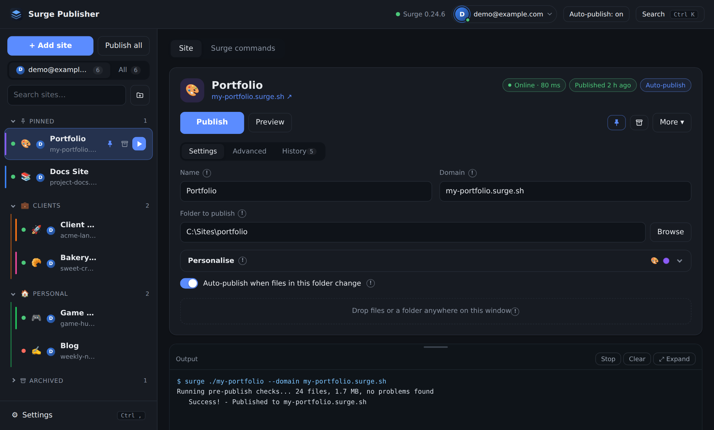

</div>

---

## What is it?

Surge is a fast, free host for static sites, but it is driven from the command line. **Surge Publisher** puts a friendly
window on top of it. You keep a list of your sites, point each one at a folder, and press **Publish**. The app checks
the folder for mistakes first, uploads it, shows live progress, and keeps a history of every publish so you can see
what happened and roll back if something goes wrong.

It is built for people who run several small sites (portfolios, client pages, docs, landing pages, side projects)
and want to manage them all in one place, including across **more than one Surge account**.

> **Note:** the screenshots in this README show the app's real interface filled with sample data.

## Highlights

| | |
|---|---|
| **One-click publishing** | Publish a site, publish a **preview** first, or **Publish all** saved sites one after another |
| **Live progress** | Upload percentage, speed, size, ETA and elapsed time, with a colour-filled bar behind the site's row |
| **Safety checks** | Warns about a missing `index.html`, private files (`.env`, keys), `.git`, `node_modules` and huge uploads before anything goes online |
| **Multiple accounts** | Switch Surge accounts like a profile menu; each site publishes with its own account |
| **Organised list** | Pin, archive, search, drag to reorder, and group sites into coloured **categories** |
| **Hands-free options** | Auto-publish when files change, scheduled publishes, tray icon and a global shortcut |
| **Seven looks** | Light, dark or automatic, plus six complete UI styles |

## Screenshots

<table>
<tr>
<td width="50%">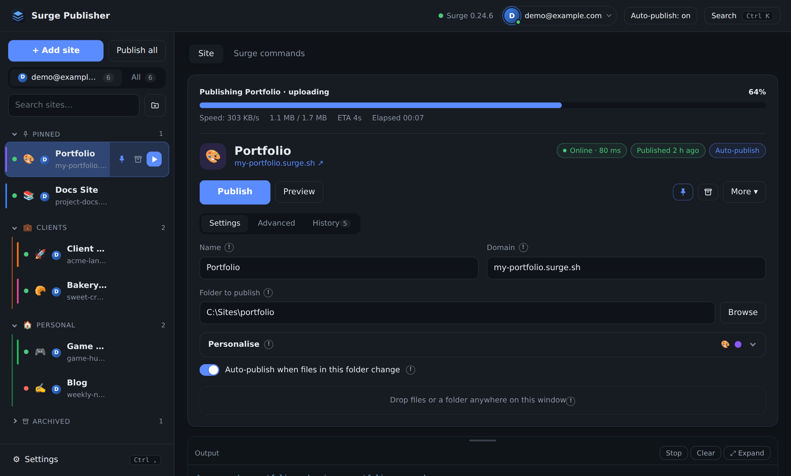<br><sub><b>Publishing</b> with live progress, speed and ETA</sub></td>
<td width="50%">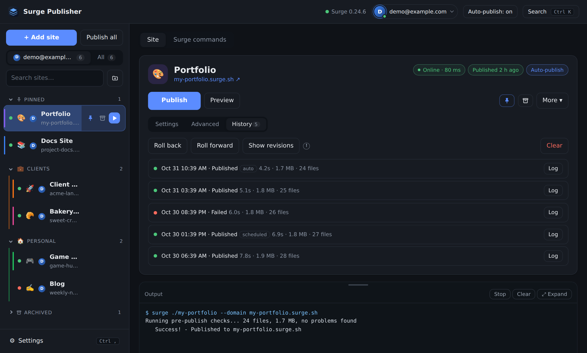<br><sub><b>History</b> of every publish, with logs and roll back / forward</sub></td>
</tr>
<tr>
<td>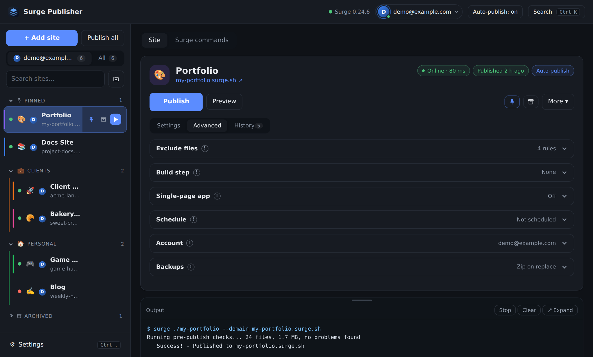<br><sub><b>Advanced options</b>: exclude rules, build step, SPA mode, schedule, backups</sub></td>
<td>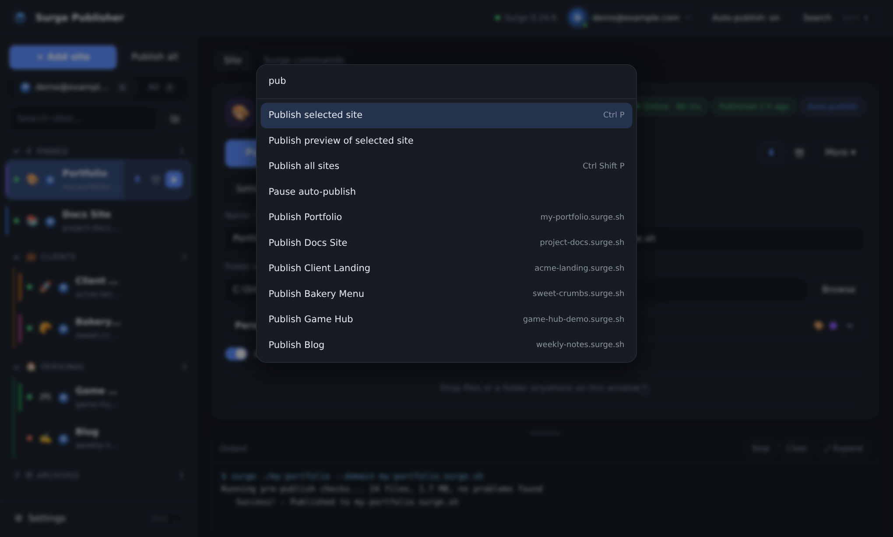<br><sub><b>Command palette</b> (<code>Ctrl K</code>) to search sites and run actions</sub></td>
</tr>
<tr>
<td>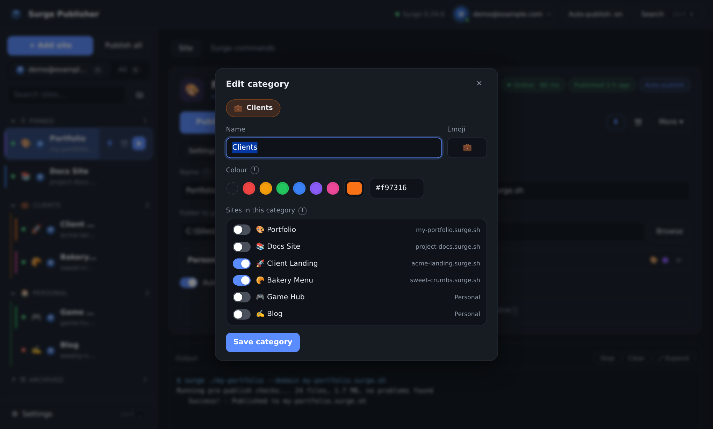<br><sub><b>Categories</b> with colours, emoji and drag-and-drop</sub></td>
<td>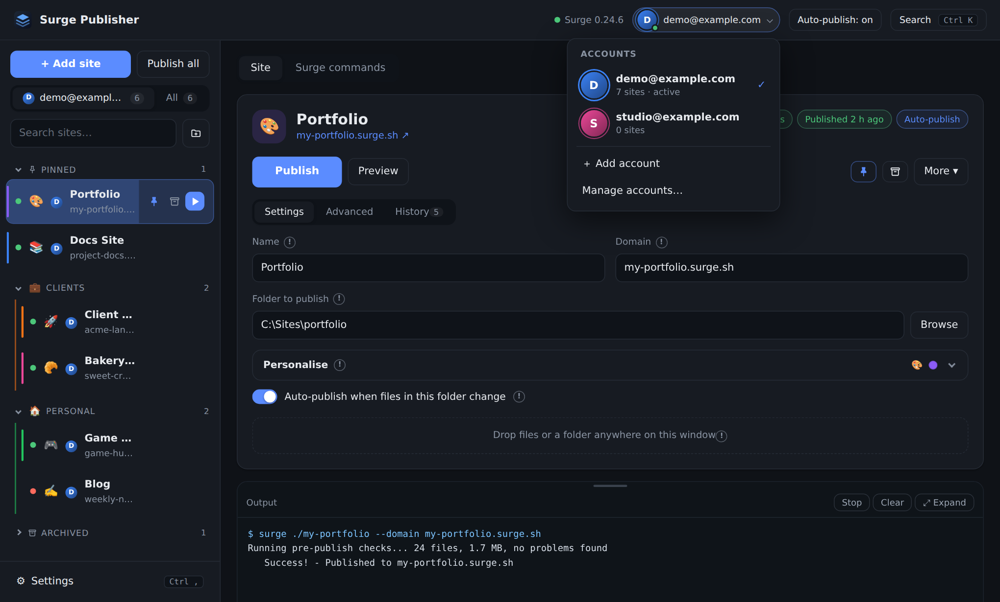<br><sub><b>Accounts</b>: switch between Surge logins</sub></td>
</tr>
<tr>
<td>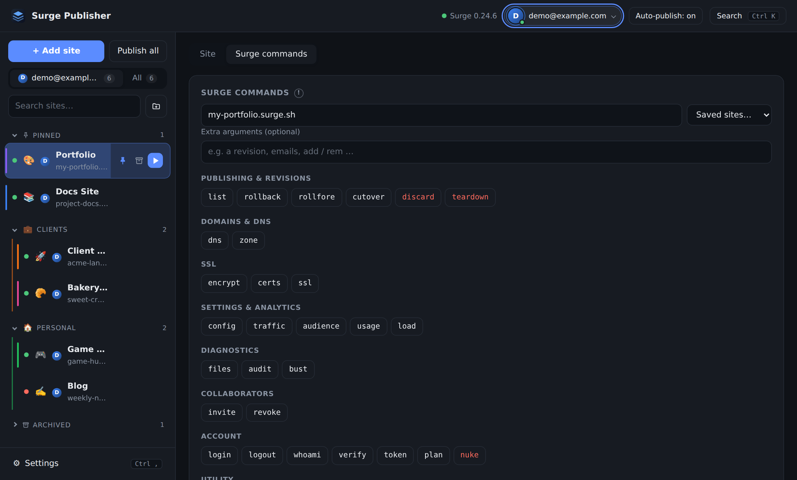<br><sub><b>Surge commands</b>: the whole Surge CLI as buttons</sub></td>
<td>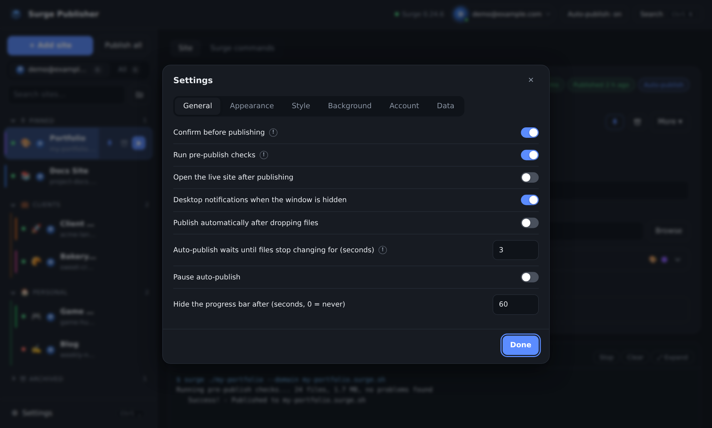<br><sub><b>Settings</b>: confirmations, checks, notifications, tray</sub></td>
</tr>
<tr>
<td>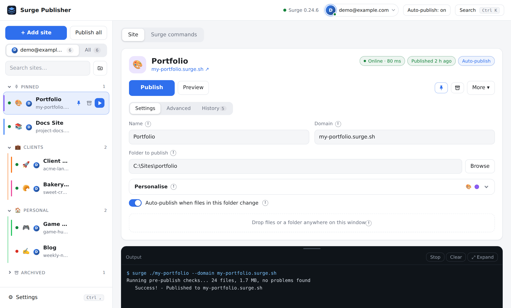<br><sub><b>Light theme</b></sub></td>
<td>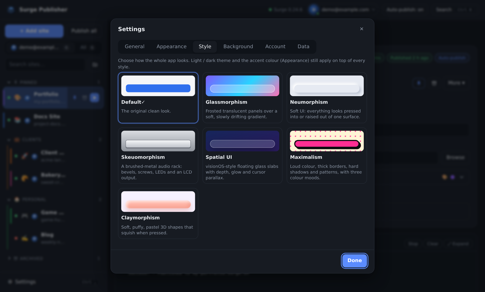<br><sub><b>Style picker</b></sub></td>
</tr>
</table>

### Six UI styles

Glassmorphism, Neumorphism, Skeuomorphism, Spatial UI, Maximalism and Claymorphism, each with its own "reduce effects" switch.

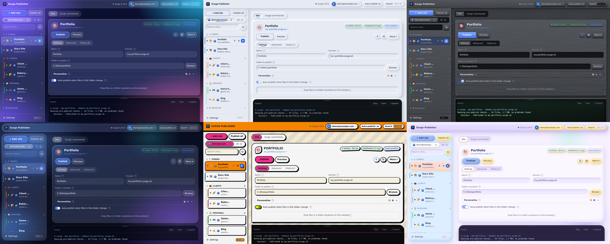

## Features in detail

### Publishing
- Publish, **preview** (a temporary link you can share before going live) or **Publish all**
- Optional **confirmation** before publishing and **desktop notification** when done
- Optional **build step**: run a command (for example `npm run build`) first and publish its output folder
- **Single-page app mode** creates a `200.html` so client-side routes work
- **Exclude rules** in a `.gitignore` style (`node_modules/`, `*.psd`, `!keep-this.png`)
- Pre-publish checks flag private-looking files and offer to add them to the exclude list
- Opens the live site automatically after publishing, if you want

### Site management
- Name, domain, folder, emoji and colour for every site
- **Pin** favourites to the top, **archive** old sites (they are skipped by Publish all, auto-publish and schedules)
- **Categories**: coloured, collapsible groups you can reorder; drag a site onto a header to move it
- Search across names, domains and categories
- Drop files or a whole folder onto the window to copy them in. Anything replaced is **backed up to a zip**, and the drop can be **undone**
- One click to create a `404.html`, copy the link, show a **QR code**, or open a **local preview**
- **Export and import** your site list as JSON. Account tokens are never exported

### Automation
- **Auto-publish** when files in a folder change, after they stop changing for a delay you choose
- **Scheduled publishes**; if the app was closed at the time, it publishes when you next open it
- **Health checks** show a green or red dot for each site (every few minutes, configurable)
- **Tray icon**, optional start with Windows, and a global shortcut (`Ctrl+Alt+P`) to publish the selected site

### History and recovery
- Every publish is recorded with its time, duration, size, file count and full log
- **Roll back** and **roll forward** using Surge's own revisions

### The Surge CLI, without the terminal
A **Surge commands** tab exposes the Surge CLI as buttons: list, teardown, DNS and zone, SSL, config, analytics
(traffic, audience, usage, load), files, audit, cache bust, invites, plans and more. Commands that need a
domain use the selected site, and interactive commands can be answered from the output panel.

### Accounts
- Add accounts with **email and password** (used once, then discarded) or a **token**
- Switch accounts from the header; filter the list to the active account or show all
- Import every site from an account with **List my Surge sites**

## Download

Get the latest Windows portable `.exe` from the [Releases page](https://github.com/farizmohd70/surge-publisher/releases).
No installer: just download and run.

## Requirements

- [Node.js](https://nodejs.org), which the app uses to install and run the Surge CLI
- A free [Surge](https://surge.sh) account (you can create one from inside the app)

## Run from source

```bash
git clone https://github.com/farizmohd70/surge-publisher.git
cd surge-publisher
npm install
npm start
```

> **Newer npm versions** block install scripts by default, which stops Electron from downloading itself.
> If `npm start` says *"Electron failed to install correctly"*, run `node node_modules/electron/install.js` once.

## Build

```bash
npm run build
```

The portable Windows build is written to `dist/`. Pushing a tag such as `v1.0.0` also builds it on GitHub Actions
and attaches the `.exe` to a Release.

## Project layout

| File | Purpose |
|---|---|
| `main.js`, `preload.js` | Electron main process and the secure bridge to the window |
| `index.html`, `styles.css`, `themes.css` | The interface and its six styles |
| `core.js` | Shared state, helpers, dialogs, colour picker, menus |
| `list.js`, `categories.js` | The site list, drag and drop, categories |
| `editor.js`, `publish.js`, `ui.js` | Site panel, publishing pipeline, settings and palette |
| `accounts.js` | Multiple-account switcher and manager |
| `files.js`, `zip.js`, `qr.js` | Pre-publish checks and staging, backup zips, QR codes (no dependencies) |

## Privacy and security

- Your site list and settings are stored **locally** on your computer.
- Account tokens are **encrypted with the operating system** (Electron `safeStorage`) and are never exported.
- Passwords are used once to sign in and are then discarded.
- The app talks to Surge when you publish, and to your own sites for the health check. Nothing else leaves your machine.

Found a vulnerability? Please read [SECURITY.md](SECURITY.md).

## Contributing

Issues and pull requests are welcome. See [CONTRIBUTING.md](CONTRIBUTING.md).

## License

[MIT](LICENSE) © farizmohd70
